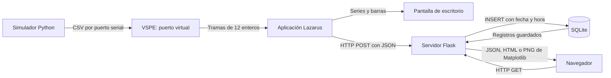

# Cómo funciona el proyecto INFO1128, paso a paso

## Primero: abre la aplicación de escritorio

**Haz doble clic en `ABRIR_ESCRITORIO.cmd`, en la carpeta principal del proyecto.**
Se abre el DataLogger: la ventana de escritorio con el selector UMA1 a UMA5,
temperatura, humedad, tres curvas de PM y seis barras de partículas.

Estos nombres corresponden a partes diferentes:

- **Lazarus** es el programa para editar y compilar el código Pascal. Abres
  `lazarus\datalogger.lpi` allí cuando quieres modificar el proyecto.
- **DataLogger** es la aplicación de escritorio que construimos con Lazarus.
  Su ejecutable es `lazarus\datalogger.exe`; también puedes abrirlo directamente.
- **El panel del navegador** muestra consultas y otra gráfica generada por
  Matplotlib con los datos guardados. Es una parte adicional que también pide
  el PDF. Los gráficos de la aplicación de escritorio se ven en su propia ventana.

Este archivo es una guía de estudio y uso del proyecto. La idea es que puedas
ejecutarlo, seguir el recorrido de una medición y explicar por qué existe cada
parte durante la defensa. Para la instalación detallada de Lazarus, sus paquetes
y VSPE, consulta también [LEEME_PRIMERO.md](LEEME_PRIMERO.md).

## 1. Qué problema resuelve

El programa representa un sistema de monitoreo ambiental con cinco estaciones,
llamadas **UMA1, UMA2, UMA3, UMA4 y UMA5**. UMA significa Unidad Medio Ambiental.
Cada estación informa material particulado, conteos de partículas, temperatura
y humedad relativa.

En este proyecto los valores los genera un simulador Python. Sirven para
comprobar la comunicación y el procesamiento; no son mediciones de un sensor
real ni permiten sacar conclusiones sobre la calidad del aire.

El recorrido completo es el siguiente:



Si tu visor no muestra Mermaid, lee el diagrama así: **Python genera; VSPE
transporta; Lazarus recibe y muestra; Flask valida; SQLite conserva; el navegador
consulta**.

Hay dos comunicaciones diferentes: la conexión serial une Python con Lazarus;
HTTP une Lazarus y el navegador con Flask. VSPE no reemplaza a Flask y Flask no
lee directamente el puerto COM.

## 2. Cómo se relaciona con lo que pide el PDF

| Parte de la pauta | Dónde se realiza |
|---|---|
| Aplicación en Lazarus Pascal | `lazarus/datalogger.lpi` y `lazarus/principal.pas` |
| Elegir UMA1 a UMA5 y mostrar temperatura/humedad | Controles de la ventana Lazarus |
| Tres series de PM1.0, PM2.5 y PM10 | TAChart y las tres `TLineSeries` |
| Ventana de 12 muestras con desplazamiento | `THistorialPM`, `AgregarMuestra` y `Graficar` |
| Histograma de seis tamaños de partículas | `TBarSeries` con seis barras |
| Recibir datos seriales mediante puerto virtual | `TLazSerial`, VSPE y `simulador.py` |
| Enviar datos con `TFPHTTPClient` y JSON | Cliente HTTP de Lazarus |
| Crear SQLite y guardar con DateTime | `servidor/esquema.sql` y `guardar()` |
| API REST consultable en JSON | Rutas `/api/registros` y `/api/registros/<registro_id>` |
| Gráfica Matplotlib visible en navegador | Ruta `/grafica.png` y página `/` |

La pauta señala defensa y entrega el viernes 30 de octubre desde las 09:00,
trabajo individual o en pareja y sin informe impreso. Esta guía adicional sirve
para estudiar; no sustituye la demostración del programa funcionando.

## 3. Qué contiene una medición

Una **trama** es un mensaje completo. En serial se transmite como una línea CSV:
valores separados por comas y un salto de línea al final. El ejemplo del tutorial
es:

```text
4,97,20,52,5593,1398,9349,1868,5142,6684,13,37
```

| Posición en Pascal | Campo JSON | Qué significa | Valor del ejemplo |
|---|---|---|---:|
| 0 | `id` | Número de la UMA, entre 1 y 5 | 4 |
| 1 | `mp01` | Concentración PM1.0 | 97 |
| 2 | `mp02` | Concentración PM2.5 | 20 |
| 3 | `mp03` | Concentración PM10 | 52 |
| 4 | `hi01` | Conteo asociado al tamaño 0.3 µm | 5593 |
| 5 | `hi02` | Conteo asociado al tamaño 0.5 µm | 1398 |
| 6 | `hi03` | Conteo asociado al tamaño 1.0 µm | 9349 |
| 7 | `hi04` | Conteo asociado al tamaño 2.5 µm | 1868 |
| 8 | `hi05` | Conteo asociado al tamaño 5.0 µm | 5142 |
| 9 | `hi06` | Conteo asociado al tamaño 10 µm | 6684 |
| 10 | `te` | Temperatura en grados Celsius | 13 |
| 11 | `hr` | Humedad relativa en porcentaje | 37 |

Las concentraciones se presentan en **µg/m³**, masa de partículas por volumen de
aire. Los tamaños de partículas se expresan en **µm**, micrómetros. Son unidades
distintas. Las seis barras muestran conteos, no temperaturas ni concentraciones.

Los nombres `mp02` y `mp03` conservan el contrato del ejercicio: representan
PM2.5 y PM10. No hay que renombrarlos sólo porque su nombre abreviado parezca
otro tamaño. El simulador genera las concentraciones y conteos de manera
independiente, siguiendo el propósito del tutorial; sus relaciones no modelan
fielmente un sensor físico.

**Doce campos y doce muestras son cosas distintas.** Una trama lleva doce
campos y corresponde a una medición de una UMA. La ventana del gráfico necesita
doce tramas de esa UMA para reunir doce muestras de cada una de las tres series.

## 4. Qué hace cada archivo

| Archivo | Responsabilidad |
|---|---|
| `requirements.txt` | Lista Flask, Matplotlib y pySerial para preparar Python |
| `protocolo.py` | Define el orden de los campos, valida y convierte entre CSV y datos Python |
| `simulador.py` | Genera mediciones y escribe las tramas en el puerto serial |
| `lazarus/datalogger.lpr` | Punto de entrada: inicia Lazarus y crea la ventana |
| `lazarus/datalogger.lpi` | Configuración del proyecto y paquetes requeridos |
| `lazarus/principal.pas` | Interfaz de escritorio, recepción, selección, gráficos y envío |
| `lazarus/protocolo_uma.pas` | Reconstrucción de líneas, validación serial e historial de doce muestras |
| `lazarus/compilar.ps1` | Compila en Windows usando la instalación local de Lazarus/FPC |
| `lazarus/vendor/TLazSerial` | Fuentes de la dependencia serial y su licencia |
| `servidor/app.py` | Servidor Flask, API, acceso a SQLite y gráfica Matplotlib |
| `servidor/esquema.sql` | Define la tabla `mediciones` y su índice |
| `servidor/templates/index.html` | Página que presenta las consultas y la gráfica |
| `prueba_api.py` | Inserta cinco registros de demostración mediante HTTP |
| `tests/test_proyecto.py` | Pruebas automáticas del protocolo y servidor con una base temporal |
| `servidor/datos/mediciones.sqlite3` | Base persistente creada al arrancar el servidor |
| `VERIFICACION.md` | Evidencia de las comprobaciones y límites de la verificación |

Los archivos de código son la receta. `.venv` contiene las dependencias de
Python y no es necesario distribuirlo: se puede reconstruir. La base SQLite sí
contiene registros y conviene conservarla si quieres mantener esas mediciones.

## 5. El simulador y el protocolo Python

`generar_datos(uma)` crea un diccionario. Por ejemplo, la clave `id` vale `4`
cuando se genera una medición de UMA4. Las demás claves reciben enteros
aleatorios dentro de los rangos elegidos por el ejercicio.

Si no se indica `--uma`, la expresión `numero % 5 + 1` produce la secuencia
1, 2, 3, 4, 5, 1, 2... El operador `%` obtiene el resto de una división. Así
un solo programa representa las cinco estaciones.

`codificar()` recorre la constante `CAMPOS`, une los valores con comas, agrega
`\n` y convierte el texto a bytes ASCII. El orden siempre debe coincidir con
el que entiende Pascal. Si se intercambiaran `te` y `hr`, el mensaje seguiría
teniendo doce números, pero la aplicación interpretaría mal su significado.

El salto `\n` marca el final del mensaje. En Pascal ese carácter se escribe
`#10`. No es un campo adicional. `serial.write()` recibe bytes, por eso no se
le envía directamente una cadena Python.

Por defecto se emite una trama cada 0.2 segundos y se recorren cinco UMA.
Lazarus recibe aproximadamente una muestra por segundo de la UMA seleccionada.
Si se usa `--uma 3 --intervalo 1`, todas las tramas pertenecen a UMA3 y también
llegan aproximadamente una vez por segundo.

`validar()` comprueba que lleguen todos los campos, que sus valores sean enteros,
que la UMA esté entre 1 y 5 y que humedad, temperatura y valores de partículas
estén dentro de los rangos admitidos. Rechaza un texto como `"30"` cuando se
espera el número `30`; tampoco acepta `true` como identificador.

## 6. Qué hace Lazarus al recibir datos

### La ventana y sus componentes

La interfaz se construye en código; no depende de un formulario `.lfm` diseñado
manualmente. `TPrincipal.Create` crea los controles y configura el serial.

- `TEdit`: permite indicar puerto COM y URL de envío.
- `TComboBox`: permite elegir la UMA.
- `TCheckBox`: habilita el envío de la UMA seleccionada al servidor.
- `TLabel`: muestra temperatura, humedad y estado.
- `TChart` y `TLineSeries`: dibujan las tres series de concentración.
- `TBarSeries`: dibuja los seis conteos de la última trama.
- `TMemo`: conserva un registro breve de eventos para diagnosticar problemas.
- `TLazSerial`: abre el puerto y notifica que llegaron bytes.

La configuración es **9600-8N1**: 9600 baudios, ocho bits de datos, sin paridad
y un bit de parada. Ambos programas deben usar la misma configuración.

### Por qué se necesita un buffer

Un puerto serial entrega un flujo de bytes. Un evento de recepción no garantiza
una trama completa: puede traer el comienzo de una línea, el final de la anterior
o varias líneas juntas.

`Recibir` acumula lo recibido en `FBuffer`. Mientras encuentra `#10`, extrae una
línea completa, la procesa y conserva el resto. Por ejemplo:

```text
Evento 1: 4,97,20,52,5593,
Evento 2: 1398,9349,1868,5142,6684,13,37\n1,50,
```

Después del segundo evento puede procesarse la trama de UMA4. El comienzo
`1,50,` se mantiene en el buffer hasta recibir el resto de esa otra medición.
Intentar convertir cada evento directamente en doce enteros perdería datos.

### Validación y selección de UMA

`ProcesarTrama` llama a `DecodificarTrama`, de `protocolo_uma.pas`. Esta función
separa la línea por comas, exige doce enteros decimales, verifica los rangos y
limita cada trama a 512 caracteres. Después, `ProcesarTrama` compara el primer
valor con la UMA seleccionada. Las funciones auxiliares no dependen de la
ventana y permiten comprobar el protocolo sin conectar un COM.

Si está elegida UMA4, las tramas de UMA1, UMA2, UMA3 y UMA5 no actualizan sus
gráficos ni se envían desde esa selección. Cuando cambias de UMA, se limpia el
historial local para evitar una línea que mezcle estaciones. Eso no borra nada
de SQLite.

### Cómo se desplazan las doce muestras

`FHistorial`, de tipo `THistorialPM`, conserva tres arreglos, uno por
concentración, y la cantidad de muestras válidas. `AgregarMuestra` agrega puntos
durante las primeras doce mediciones. La medición número trece desplaza las
existentes una posición hacia la izquierda y ocupa el último lugar:

```text
Antes:   [m1, m2, m3, ..., m11, m12]
Después: [m2, m3, m4, ..., m12, m13]
```

Se vuelve a dibujar cada serie usando las muestras que realmente existen.
El gráfico de barras, en cambio, usa únicamente los seis conteos de la última
trama válida; no es un historial de doce histogramas.

### Qué significa activar el envío

La casilla habilita la conversión de las mediciones seleccionadas a JSON y su
envío HTTP. Tener datos dibujados en Lazarus no demuestra todavía que se hayan
guardado. La confirmación de almacenamiento es la respuesta **HTTP 201** de
Flask. Si se informa un error HTTP, revisa el registro, recupera la conexión y
vuelve a habilitar el envío según indique el programa.

El envío de `EnviarAFlask` es síncrono: la ventana espera a que termine la
solicitud. Se configuran dos segundos para conectar y dos segundos para las
operaciones de entrada/salida. Un servidor lento puede producir una pausa en
la interfaz. Si el envío falla, se desmarca la casilla y se registra el error;
la medición fallida no se reenvía automáticamente. Para la demostración local,
inicia Flask antes de activar la casilla.

## 7. De CSV a JSON y de JSON a SQLite

La misma medición del ejemplo se envía a `http://127.0.0.1:7070/data` con este
cuerpo:

```json
{
  "id": 4,
  "mp01": 97,
  "mp02": 20,
  "mp03": 52,
  "hi01": 5593,
  "hi02": 1398,
  "hi03": 9349,
  "hi04": 1868,
  "hi05": 5142,
  "hi06": 6684,
  "te": 13,
  "hr": 37
}
```

CSV identifica los valores por su posición; JSON los identifica por nombres.
`TJSONObject` construye ese objeto sin tener que concatenar las comillas
manualmente. `TFPHTTPClient` realiza la solicitud y el encabezado
`Content-Type: application/json` le indica a Flask cómo interpretar el cuerpo.

En `guardar()` ocurre lo siguiente:

1. Se comprueba que la solicitud declare un cuerpo JSON.
2. Se valida el contenido mediante `validar()`.
3. El servidor genera la fecha y hora de recepción en UTC.
4. Se ejecuta un `INSERT` en la tabla `mediciones`.
5. Se confirma la transacción y se responde con el registro guardado.

El `INSERT` usa parámetros `?` para pasar valores a SQLite, en lugar de
concatenar datos de la solicitud dentro del SQL.

La tabla tiene **catorce columnas**: los doce campos de la trama, un
`registro_id` autoincremental y `fecha_hora`.

- **`id` identifica la UMA.** Puede repetirse porque una estación produce
  muchas mediciones.
- **`registro_id` identifica una fila.** SQLite lo asigna y es único en la tabla.
- **`fecha_hora` identifica cuándo recibió esa medición el servidor.** No es
  una hora enviada por el simulador ni por un sensor.

La columna se declara `DATETIME`; SQLite conserva aquí una cadena ISO 8601
con zona horaria, por ejemplo `2026-10-29T15:20:30.123456+00:00`. El sufijo
`+00:00` indica UTC. La hora mostrada puede diferir del reloj local de Chile,
porque no se está presentando en la zona horaria local.

Una consulta SQL equivalente a pedir las doce filas más recientes de UMA4 es:

```sql
SELECT * FROM mediciones
WHERE id = 4
ORDER BY registro_id DESC
LIMIT 12;
```

El servidor invierte después esa selección para devolverla de la más antigua
a la más nueva. El límite acota la consulta, **no borra las filas anteriores**.
El índice por UMA y registro ayuda a encontrar esas mediciones.

## 8. Cómo funciona la API REST

Una API es una forma definida de comunicarse con un programa. Aquí se usan
rutas HTTP y datos JSON. Para agregar una medición se usa **POST**; para
consultar se usa **GET**. Escribir una URL en el navegador hace una consulta
GET, no un POST.

| Método y ruta | Resultado |
|---|---|
| `GET /api/estado` | Comprueba que Flask está respondiendo |
| `POST /data` | Valida y guarda una medición |
| `POST /api/registros` | Alternativa para guardar la misma estructura |
| `GET /api/registros` | Consulta registros de todas las UMA |
| `GET /api/registros?uma=4&limite=12` | Consulta las últimas doce filas de UMA4 |
| `GET /api/registros/25` | Consulta la fila cuyo `registro_id` es 25 |
| `GET /data` | Alternativa para consultar registros |
| `GET /grafica.png?uma=4&limite=12` | Devuelve una imagen PNG hecha con Matplotlib |
| `GET /?uma=4&limite=12` | Abre el panel web de UMA4 |

Los parámetros después de `?` filtran la consulta. `uma` acepta valores de
1 a 5; `limite` acepta entre 1 y 500. La API devuelve 100 registros como máximo
por defecto; el panel web y la gráfica muestran doce por defecto.

La lista JSON contiene:

- `total`: cuántas filas coinciden en toda la base, antes de aplicar el límite.
- `devueltos`: cuántas filas contiene esta respuesta.
- `registros`: las filas con sus campos, identificadores y fecha/hora.

Por ejemplo, si hay 80 filas de UMA4 y pides `limite=12`, `total` vale 80 y
`devueltos` vale 12. No significa que se hayan perdido las otras 68.

| Código HTTP | Cómo interpretarlo |
|---|---|
| `200 OK` | La consulta se completó |
| `201 Created` | La medición quedó guardada |
| `400 Bad Request` | Hay campos, valores, JSON o parámetros inválidos |
| `404 Not Found` | No existe el registro individual consultado |
| `415 Unsupported Media Type` | No se declaró `application/json` al enviar |

Al guardar, el encabezado `Location` señala la URL desde la que se puede
recuperar la fila creada. Una lista vacía con `200` es un resultado válido:
la consulta funcionó, pero aún no hay datos para ese filtro.

## 9. Por qué hay dos gráficos distintos

Lazarus dibuja con **TAChart** las tramas que recibe por serial. El servidor
dibuja con **Matplotlib** las filas que recupera de SQLite. Esto permite mostrar
que el almacenamiento y la consulta funcionan, incluso después de reiniciar
el servidor.

En `grafica()` se crea una `Figure` con dos zonas: series de concentración
arriba y seis barras de la última medición abajo. `FigureCanvasAgg` dibuja el
PNG en memoria dentro de un `BytesIO`; Flask lo entrega con el tipo
`image/png`. No necesita abrir una ventana de Matplotlib en el escritorio.

El HTML muestra la imagen con ``. El panel también presenta temperatura,
humedad, concentraciones y una tabla con todos los campos. Cada cinco segundos
consulta la API y solicita una imagen actualizada. Si el servidor no responde,
el panel informa el problema y conserva la última información mostrada.

Si Lazarus está en UMA4 y el navegador en UMA1, sus gráficos pueden verse
distintos. También puede haber diferencias porque la casilla de envío estuvo
desactivada: Lazarus muestra recepción local y el navegador muestra sólo lo
que llegó a guardarse.

## 10. Cómo ejecutar todo en tu computador

### Preparación de Python

Abre PowerShell en la raíz del proyecto, la carpeta que contiene
`requirements.txt`. En este computador la ruta es:

```powershell
cd 'C:\Users\benja\Documents\GitHub\proyecto2interface'
```

Si `.venv` ya funciona, instala o comprueba las dependencias con:

```powershell
.\.venv\Scripts\python.exe -m pip install -r requirements.txt
.\.venv\Scripts\python.exe -c "import flask, serial, matplotlib, sqlite3; print('Dependencias listas')"
```

Si todavía no existe el entorno, créalo primero con el Python instalado:

```powershell
py -3.13 -m venv .venv
```

Si el comando `py` no está disponible, usa la ruta de tu instalación de Python
para ejecutar `-m venv .venv`. En PowerShell una ruta de ejecutable entre
comillas se invoca con `&`, por ejemplo:

```powershell
& 'C:\Users\benja\AppData\Local\Programs\Python\Python313\python.exe' -m venv .venv
```

Adapta esa ruta si Python está instalado en otra ubicación. No copies un
`.venv` desde otro computador: puede guardar rutas que no existen en el tuyo.
Usar directamente `.venv\Scripts\python.exe` evita tener que activar el entorno
o modificar la política de ejecución de PowerShell.

### Arranque habitual: cuatro partes

1. **VSPE:** crea e inicia un dispositivo **Connector COM2**. Con Connector,
   Python y Lazarus usan el mismo COM2. Si elegiste un dispositivo Pair, deben
   usar los dos extremos distintos, por ejemplo COM2 y COM3.
2. **Flask:** en una terminal, desde la raíz, ejecuta:

   ```powershell
   .\.venv\Scripts\python.exe -m servidor.app
   ```

   Deja la terminal abierta. Comprueba en el navegador
   `http://127.0.0.1:7070/api/estado`.
3. **Lazarus:** compila con el script incluido, desde la raíz:

   ```powershell
   powershell -NoProfile -ExecutionPolicy Bypass -File .\lazarus\compilar.ps1
   ```

   El script usa por defecto `C:\lazarus`. Si tu instalación está en otro lugar,
   agrega `-LazarusDir 'C:\ruta\de\lazarus'`. Usa las fuentes seriales incluidas
   en `lazarus/vendor/TLazSerial`, por lo que este camino no requiere instalar
   TLazSerial globalmente en el IDE. `-ExecutionPolicy Bypass` se aplica a esa
   invocación de PowerShell; no cambia la política permanente del equipo.

   El ejecutable resultante es `lazarus\datalogger.exe`. Ábrelo, elige UMA1,
   comprueba puerto y URL `http://127.0.0.1:7070/data`, pulsa **Conectar** y
   habilita el envío cuando Flask esté listo.

   También puedes abrir `lazarus\datalogger.lpi` en el IDE para estudiar y editar.
   En ese camino revisa sus paquetes LCL, TAChartLazarusPkg y LazSerialPort;
   abre el `.lpk` de TLazSerial incluido si debes registrar su ubicación. La guía
   de instalación detalla el manejo de paquetes en el IDE.
4. **Simulador:** abre otra terminal en la misma raíz y ejecuta:

   ```powershell
   .\.venv\Scripts\python.exe simulador.py --puerto COM2
   ```

   Con un Pair, indica aquí el extremo reservado a Python y en Lazarus el otro.

Finalmente abre `http://127.0.0.1:7070/` y selecciona la misma UMA que en
Lazarus. Detén el simulador con `Ctrl+C`, desconecta el COM en Lazarus y detén
Flask con `Ctrl+C` en su terminal al terminar.

### Comprobar partes por separado

Para ver cinco tramas sin usar ningún COM:

```powershell
.\.venv\Scripts\python.exe simulador.py --ver --cantidad 5
```

Para comprobar Flask sin abrir Lazarus, con el servidor ya arrancado:

```powershell
.\.venv\Scripts\python.exe prueba_api.py
```

Ese comando **agrega cinco filas de demostración a la base activa**, una por
UMA. Sirve para probar POST, almacenamiento, JSON y gráfica. No prueba el tramo
serial ni demuestra por sí solo que Lazarus esté enviando.

Para emitir sólo UMA3:

```powershell
.\.venv\Scripts\python.exe simulador.py --puerto COM2 --uma 3 --intervalo 1
```

En ese caso selecciona UMA3 en Lazarus; otra selección no mostrará esas tramas.

Para ejecutar las pruebas automáticas:

```powershell
.\.venv\Scripts\python.exe -m unittest discover -s tests -v
```

Las pruebas crean su propia base temporal. La evidencia de qué se ejecutó al
preparar esta entrega se encuentra en `VERIFICACION.md`.

El script de compilación también permite solicitar las pruebas Pascal del
protocolo y del historial:

```powershell
powershell -NoProfile -ExecutionPolicy Bypass -File .\lazarus\compilar.ps1 -Probar
```

Compilar y ejecutar son comprobaciones diferentes. Si Windows bloquea un
ejecutable por una política del equipo, esa situación debe resolverse en el
entorno de la demostración; un mensaje de compilación correcta no demuestra
por sí solo que se abrió la interfaz o funcionó el circuito VSPE.

## 11. Guion para demostrar el proyecto

| Acción durante la demostración | Qué demuestra |
|---|---|
| Mostrar VSPE y conectar Lazarus al COM | Existe el enlace serial solicitado |
| Iniciar Python y observar temperatura, humedad y gráficos | Lazarus interpreta la trama |
| Esperar trece muestras de una UMA | La ventana se limita a doce y se desplaza |
| Cambiar de UMA1 a UMA4 | Se aplica la selección y se limpia el historial local |
| Activar el envío y ver HTTP 201 | Se ejecuta el POST y Flask confirma el guardado |
| Abrir `/api/registros?uma=4&limite=12` | Se consultan registros de SQLite como JSON |
| Abrir un enlace de registro individual | `registro_id` identifica una fila concreta |
| Mostrar `fecha_hora` con su zona horaria | Cada registro tiene DateTime de recepción |
| Abrir el panel web y la imagen `/grafica.png?uma=4` | Matplotlib genera la gráfica visible en navegador |
| Desactivar el envío y seguir recibiendo tramas | Recepción local y almacenamiento son procesos separados |
| Detener y reiniciar Flask, luego consultar de nuevo | Las filas persisten en el archivo SQLite |

Para comprobar persistencia con claridad, anota un `registro_id`, detén el
simulador, desactiva el envío y reinicia Flask. Busca después ese mismo registro.
Así evitas confundir filas nuevas con las que ya existían.

No basta con mostrar capturas: prepara también el recorrido funcionando en el
equipo de la defensa. No borres la base que quieres usar durante la exposición.

## 12. Cómo encontrar un problema sin perderse

Sigue el recorrido de los datos y comprueba una etapa por vez:

| Síntoma | Comprobación concreta |
|---|---|
| No se reconoce Python | Usa el ejecutable del entorno o la ruta del Python instalado |
| Falta `flask`, `serial` o `matplotlib` | Instala `requirements.txt` con el mismo Python que ejecuta el programa |
| `No module named servidor` | Abre la terminal en la raíz y usa `-m servidor.app` |
| Falla la compilación por `LazSerial` | Usa el script incluido; si compilas en el IDE, revisa el paquete local LazSerialPort |
| Falla por `TAGraph` o `TASeries` | Comprueba el paquete TAChartLazarusPkg |
| No abre el COM | Comprueba VSPE activo, COM existente y Connector frente a Pair |
| Python imprime, pero Lazarus no cambia | Comprueba los extremos COM, 9600-8N1 y la UMA seleccionada |
| Se descartan tramas | Comprueba doce enteros en el orden acordado y el salto de línea |
| Lazarus grafica, pero no aumenta la API | Comprueba casilla, mensaje HTTP, URL y que Flask esté iniciado |
| La web no tiene datos de una UMA | Comprueba que se enviaron filas de esa UMA; cambiar el selector web no genera datos |
| La web informa que no pudo actualizar | Comprueba Flask y el puerto 7070; vuelve a consultar cuando responda |
| La hora parece distinta | Recuerda que `fecha_hora` y los gráficos se presentan en UTC |
| Puerto 7070 ocupado | Comprueba si ya hay otra instancia de Flask ejecutándose |

`http://127.0.0.1` significa este mismo computador. Si el servidor se ejecuta
en otro equipo, esa dirección ya no apunta a él y habría que configurar red y
direcciones; la configuración de esta práctica usa todo en el mismo equipo.

## 13. Respuestas breves para la defensa

**¿Por qué se usa un puerto virtual?** Permite que el simulador y Lazarus se
comuniquen como si hubiera un sensor conectado por serial, sin necesitar ese
dispositivo físico.

**¿Qué hace el salto de línea?** Delimita una trama completa dentro del flujo
serial. El buffer permite esperar si sólo llegó una parte.

**¿Dónde se elige la estación?** En el selector de Lazarus. Se compara con el
primer campo `id` de cada trama.

**¿Qué datos se guardan?** Los doce valores enviados, más la fecha/hora de
recepción y un identificador único de registro.

**¿Por qué hay dos identificadores?** `id` indica la estación y puede repetirse;
`registro_id` distingue una fila de todas las demás.

**¿Por qué no desaparece la base al cerrar?** SQLite guarda un archivo en disco.
Los gráficos locales usan memoria y el historial se pierde al cerrar Lazarus;
los registros almacenados permanecen.

**¿Quién dibuja la gráfica del navegador?** Python con Matplotlib. Flask devuelve
la imagen y el navegador la muestra.

**¿La API entrega sólo doce registros?** El cliente de escritorio mantiene doce
muestras en memoria. La API puede consultar entre 1 y 500 filas por solicitud,
con cien por defecto; el panel empieza mostrando doce.

**¿Qué prueba HTTP 201?** Que el servidor aceptó esa medición y completó su
inserción. Ver una línea en Lazarus sólo prueba la recepción y el dibujo local.

**¿Hay mediciones reales?** No. El simulador produce datos aleatorios para
demostrar la arquitectura pedida.

## 14. Orden recomendado para estudiar el código

1. Lee `CAMPOS` y `validar()` en `protocolo.py`: define qué significa el mensaje.
2. Lee `generar_datos()` y el bucle de `simulador.py`: explica de dónde sale.
3. Lee `ExtraerLinea`, `DecodificarTrama` y `AgregarMuestra` en
   `protocolo_uma.pas`; después `Recibir`, `ProcesarTrama` y `Graficar` en
   `principal.pas`: explica cómo llega el mensaje y aparece en pantalla.
4. Lee el envío HTTP de Pascal y `guardar()` en Flask: sigue el mismo mensaje
   hasta la base.
5. Lee `esquema.sql`, `consultar()`, `listar()` y `obtener()`: explica cómo
   permanece y cómo se recupera.
6. Lee `grafica()` y `index.html`: explica cómo se presenta lo almacenado.
7. Ejecuta el guion de demostración mientras explicas cada paso con tus propias
   palabras. Si una etapa falla, usa la tabla de diagnóstico antes de cambiar
   varias configuraciones a la vez.
